A simple Linux clone for x86.

## Screenshots

**startup**

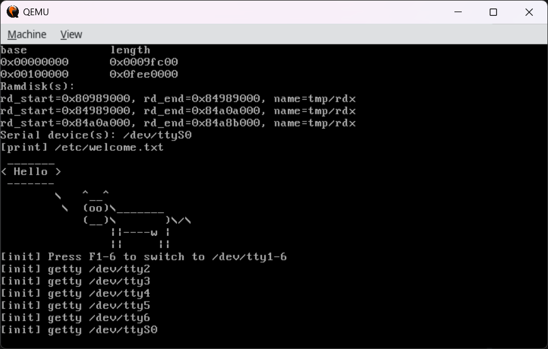

**oksh**

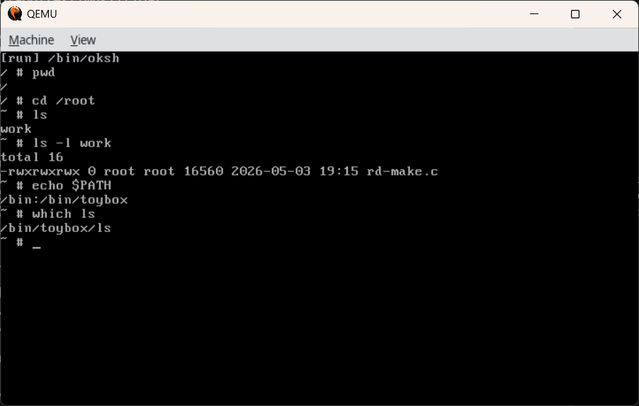

**vim**

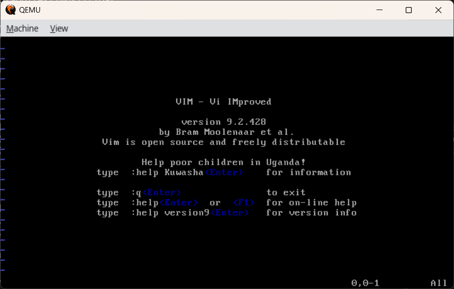

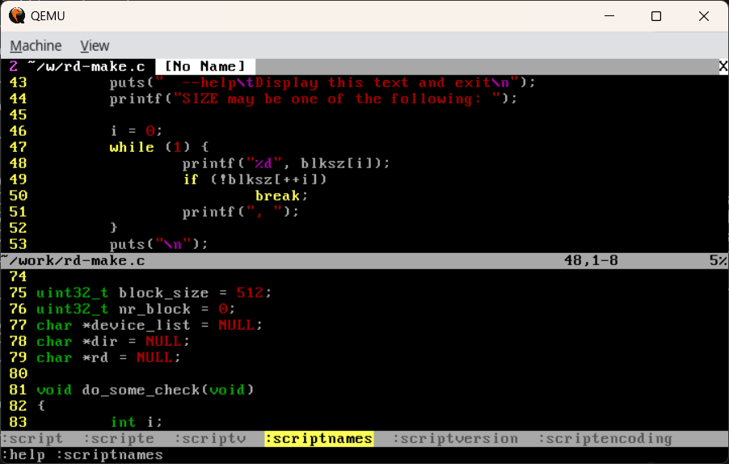

**nano**

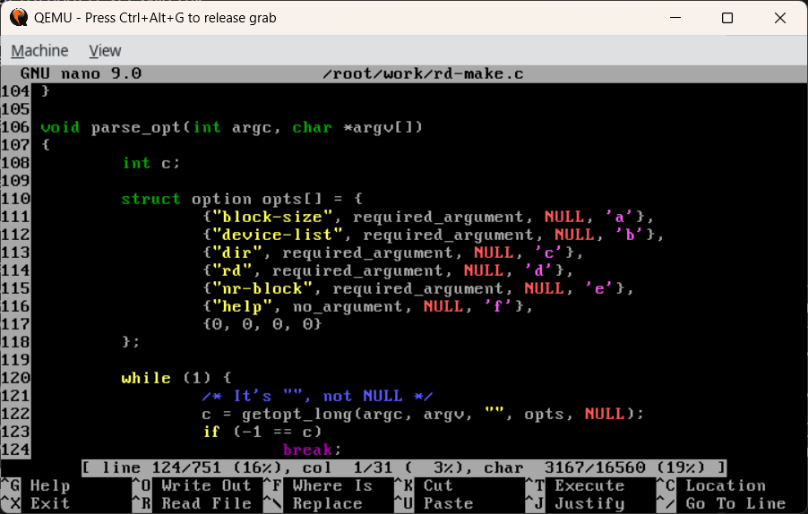

**less**

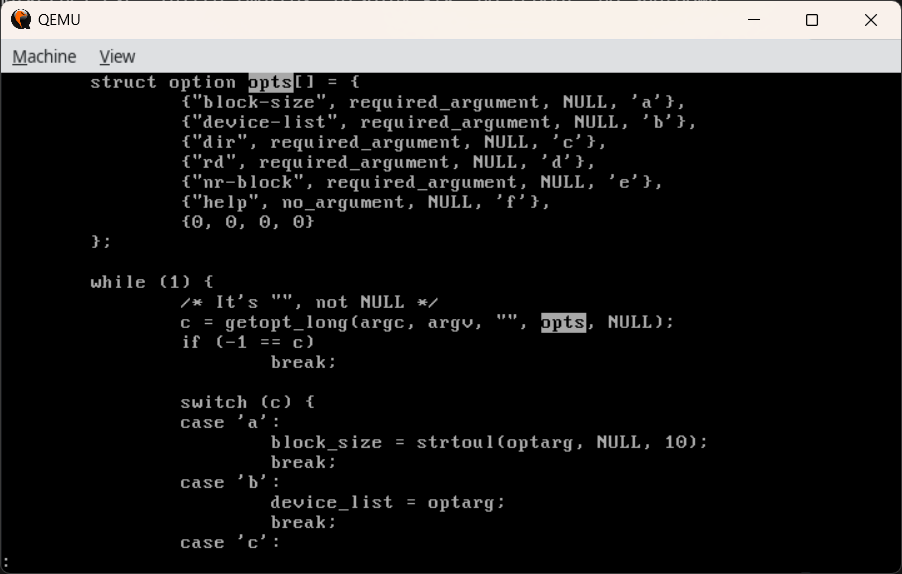

**python**

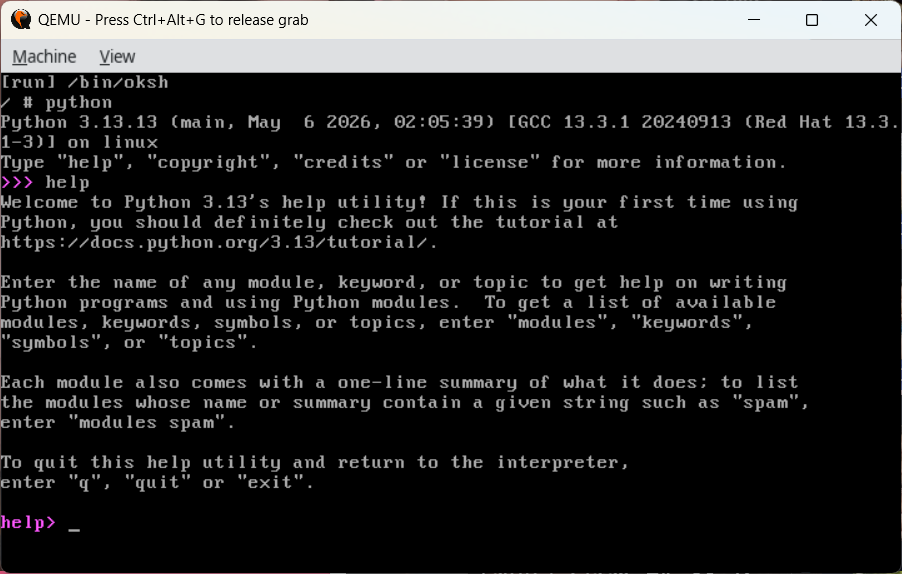

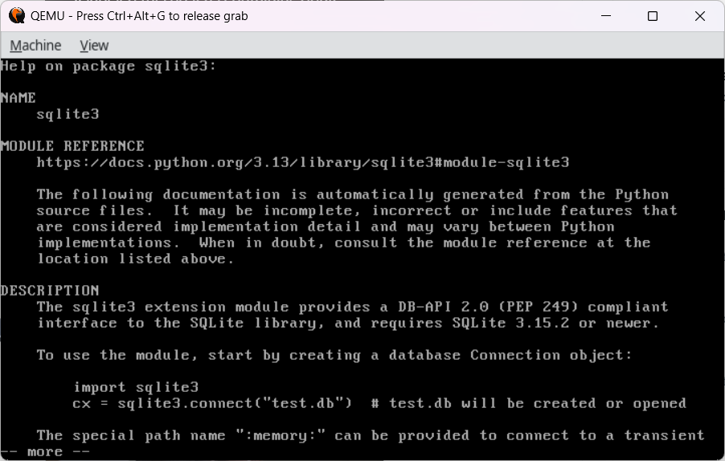

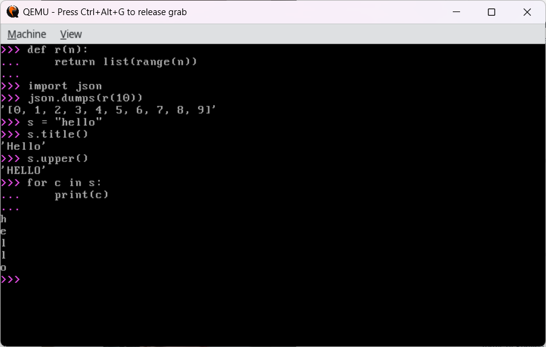

**cmatrix**

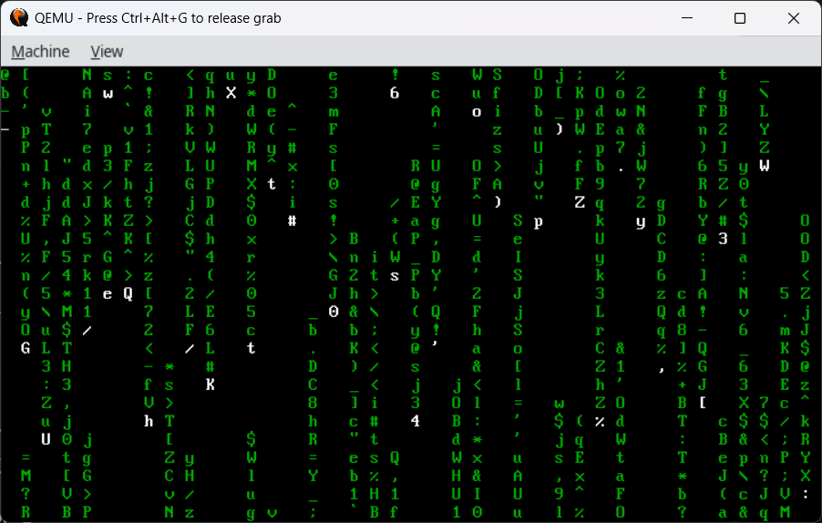

**2048**

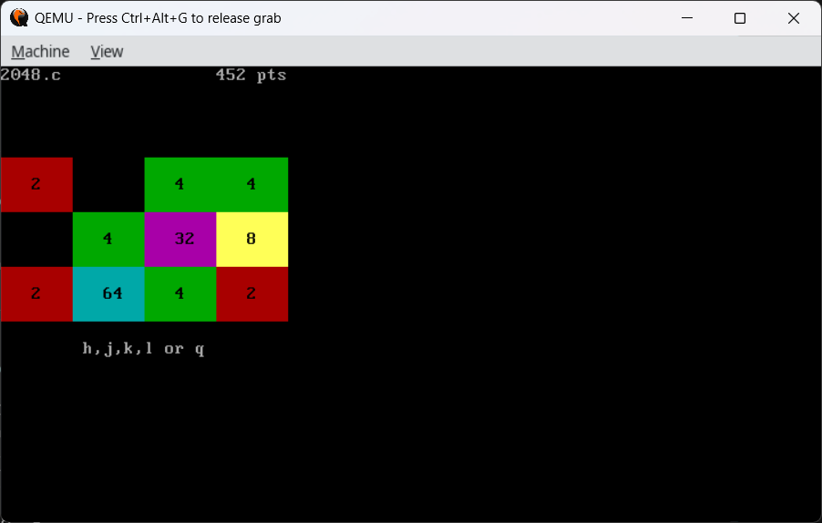

## Prerequisites

Dependencies for the supported distros are maintained in text files:

- `.github/ci/ubuntu-build-packages.txt`
- `.github/ci/ubuntu-test-packages.txt`
- `.github/ci/fedora-build-packages.txt`
- `.github/ci/fedora-test-packages.txt`

For a **host build**, install both the build and test lists. On Ubuntu:

```
$ sudo apt-get update
$ sudo apt-get install -y $(grep -hEv '^[[:space:]]*#|^[[:space:]]*$' \
    .github/ci/ubuntu-build-packages.txt .github/ci/ubuntu-test-packages.txt)
```

On Fedora:

```
$ sudo dnf install -y $(grep -hEv '^[[:space:]]*#|^[[:space:]]*$' \
    .github/ci/fedora-build-packages.txt .github/ci/fedora-test-packages.txt)
```

For a **container build**, install only the host test/image-generation
dependencies plus `podman`. The build dependencies are installed inside the
container image from the matching `*-build-packages.txt` file.

On Ubuntu:

```
$ sudo apt-get update
$ sudo apt-get install -y podman $(grep -hEv '^[[:space:]]*#|^[[:space:]]*$' \
    .github/ci/ubuntu-test-packages.txt)
```

On Fedora:

```
$ sudo dnf install -y podman $(grep -hEv '^[[:space:]]*#|^[[:space:]]*$' \
    .github/ci/fedora-test-packages.txt)
```

## Build

### 1. Choose host or container build

`make kernel app` and `make` build inside the recorded container when
`.build-env` exists, and directly on the host otherwise.

To build on the host, continue to step 2. If `.build-env` exists from an
earlier container build, switch back first with `make clean-container-env`.

To build in a container:

```
$ make BUILD_IMAGE=ubuntu:26.04 container
```

Available images: `ubuntu:23.10`, `ubuntu:26.04`, `fedora:39`, and
`fedora:45`.

Switching to a different container image cleans the current kernel and app
build outputs first, because they are no longer valid for the new build
environment.

The selected image is recorded in `.build-env`, so later `make container`
calls can omit `BUILD_IMAGE`. With neither `.build-env` nor `BUILD_IMAGE`,
`make container` does nothing.

To switch back to a host build later:

```
$ make clean-container-env
```

### 2. Build kernel and app

```
$ make kernel app
```

or simply:

```
$ make
```

Use `DEBUG=0` and `OPTIMIZE=-O3` when needed:

```
$ make DEBUG=0 OPTIMIZE=-O3 kernel app
```

Image and test targets create `.venv` automatically when it is missing.

### 3. Create disk images

```
$ make disk-image
```

For a specific grub4dos menu:

```
$ make disk-image-text
$ make disk-image-vbe_1024x768
$ make disk-image-vbe_1920x1080
```

## Test

```
$ make test
```

`make test` builds the VBE 1024x768 disk image and runs the shell, TTY, and
GUI tests. Adjust SMP or parallelism:

```
$ make SMP=4 LIT_JOBS=1 test
```

## Run

```
$ make run
```

Other variants:

```
$ make run-gtk
$ make quick-run
$ make quick-run-gtk
```

## Debug

```
$ make debug
```

```
$ ./gdb.sh
```

Other variants:

```
$ make debug-gtk
$ make quick-debug
$ make quick-debug-gtk
```

## Clean

```
$ make clean
$ make clean-all
$ make clean-src
```
