[](https://github.com/FLZ101/mario/actions/workflows/ci.yml)

A simple Linux clone for x86.

## Screenshots

**startup**

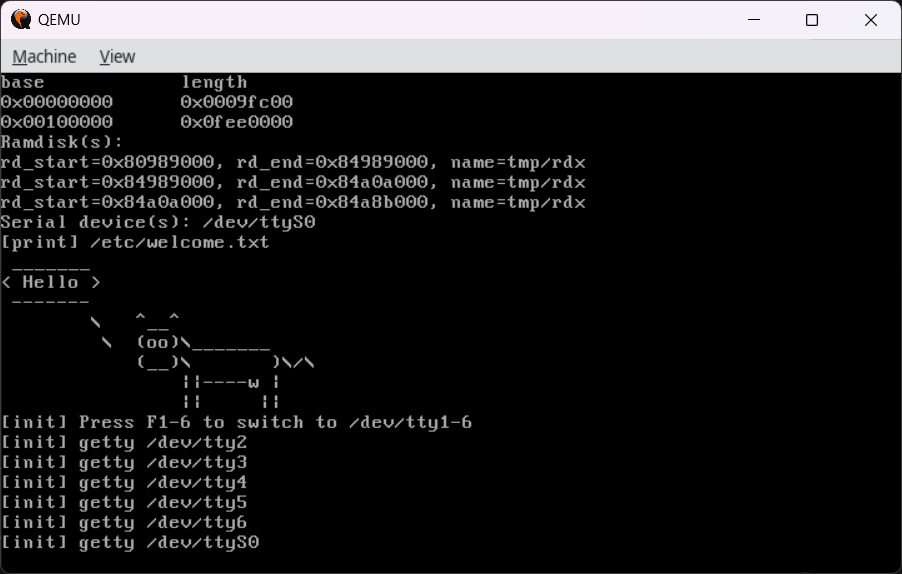

**oksh**

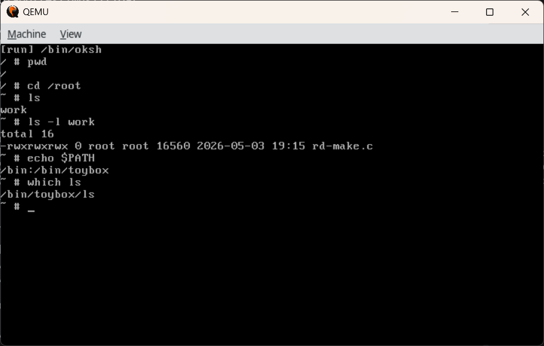

**vim**

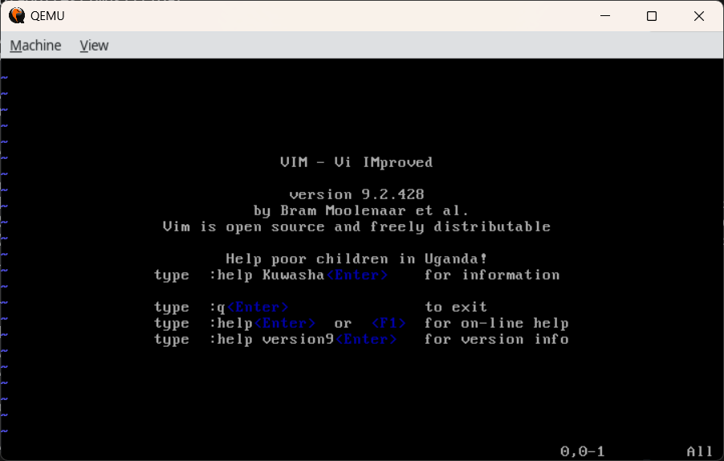

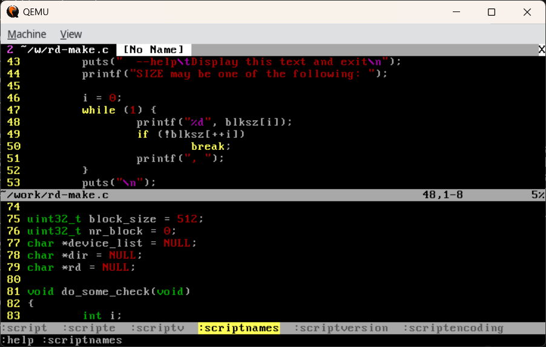

**nano**

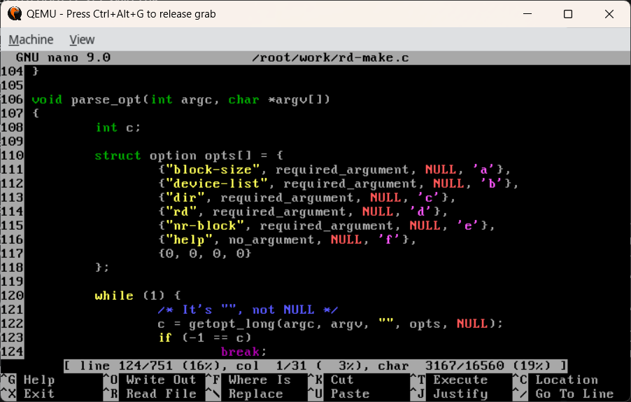

**less**

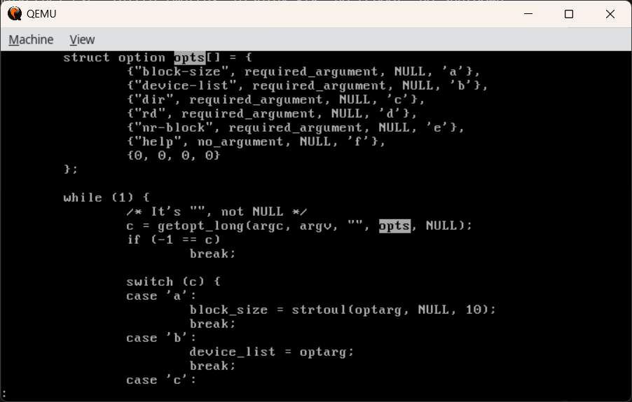

**python**

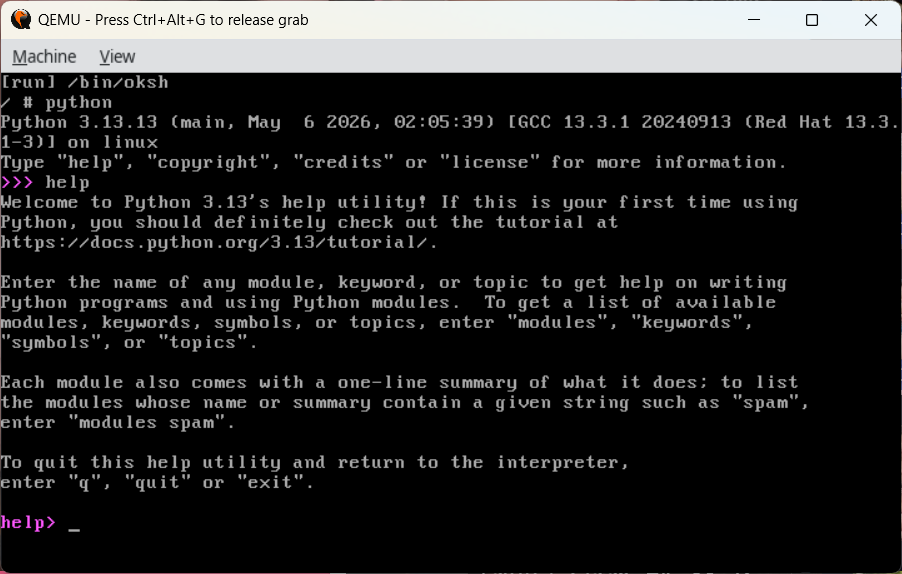

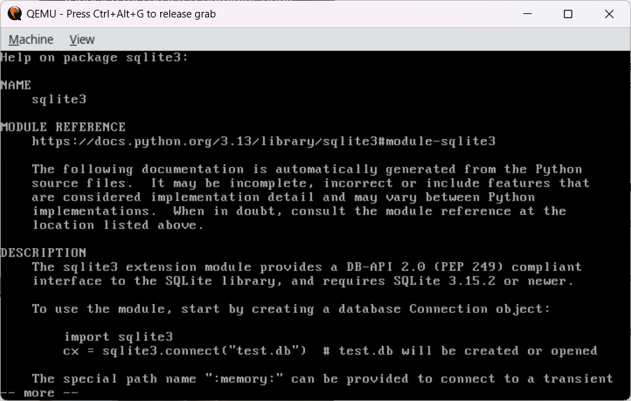

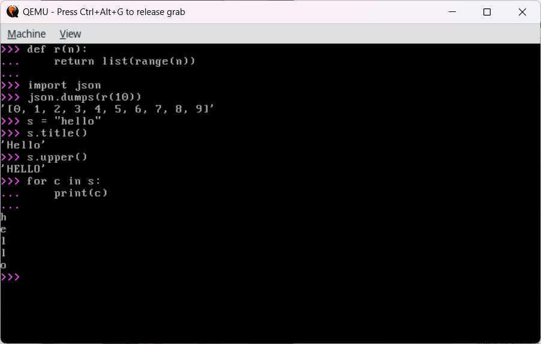

**cmatrix**

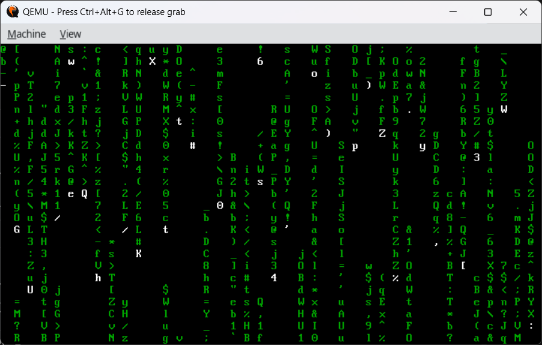

**2048**

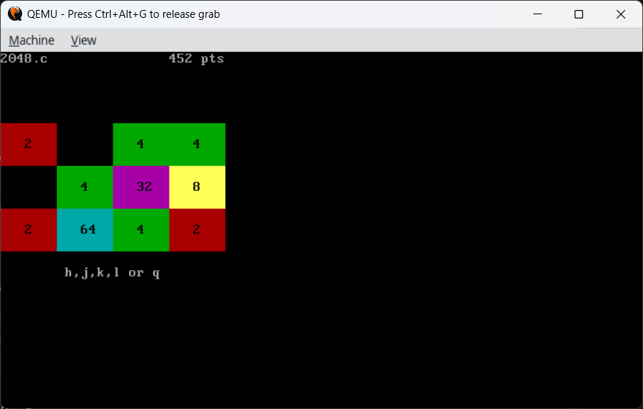

## Prerequisites

Dependencies for the supported distros are maintained in text files:

- `.github/ci/ubuntu-build-packages.txt`
- `.github/ci/ubuntu-test-packages.txt`
- `.github/ci/fedora-build-packages.txt`
- `.github/ci/fedora-test-packages.txt`

For a **host build**, install both the build and test lists. On Ubuntu:

```
$ sudo apt-get update
$ sudo apt-get install -y $(grep -hEv '^[[:space:]]*#|^[[:space:]]*$' \
    .github/ci/ubuntu-build-packages.txt .github/ci/ubuntu-test-packages.txt)
```

On Fedora:

```
$ sudo dnf install -y $(grep -hEv '^[[:space:]]*#|^[[:space:]]*$' \
    .github/ci/fedora-build-packages.txt .github/ci/fedora-test-packages.txt)
```

For a **container build**, install only the host test/image-generation
dependencies plus `podman`. The build dependencies are installed inside the
container image from the matching `*-build-packages.txt` file.

On Ubuntu:

```
$ sudo apt-get update
$ sudo apt-get install -y podman $(grep -hEv '^[[:space:]]*#|^[[:space:]]*$' \
    .github/ci/ubuntu-test-packages.txt)
```

On Fedora:

```
$ sudo dnf install -y podman $(grep -hEv '^[[:space:]]*#|^[[:space:]]*$' \
    .github/ci/fedora-test-packages.txt)
```

## Build

### 1. Choose host or container build

`make kernel app` and `make` build inside the recorded container when
`.build-env` exists, and directly on the host otherwise.

To build on the host, continue to step 2. If `.build-env` exists from an
earlier container build, switch back first with `make clean-container-env`.

To build in a container:

```
$ make BUILD_IMAGE=ubuntu:26.04 container
```

Available images: `ubuntu:23.10`, `ubuntu:26.04`, `fedora:39`, and
`fedora:45`.

Switching to a different container image cleans the current kernel and app
build outputs first, because they are no longer valid for the new build
environment.

The selected image is recorded in `.build-env`, so later `make container`
calls can omit `BUILD_IMAGE`. With neither `.build-env` nor `BUILD_IMAGE`,
`make container` does nothing.

To switch back to a host build later:

```
$ make clean-container-env
```

### 2. Build kernel and app

```
$ make kernel app
```

or simply:

```
$ make
```

Use `DEBUG=0` and `OPTIMIZE=-O3` when needed:

```
$ make DEBUG=0 OPTIMIZE=-O3 kernel app
```

Host app, image, and test targets create `.venv` and install `requirements.txt`
automatically, including Meson, Ninja, and Jinja2 for the mpv build. Container app
builds create a separate venv under `.venv/build-<image>` using the container's
Python.

## Test

```
$ make test
```

`make test` builds the VBE 1024x768 disk image and runs the shell, TTY, and
GUI tests. Adjust SMP or parallelism:

```
$ make SMP=4 LIT_JOBS=1 test
```

## Run

```
$ make run
```

Other variants:

```
$ make run-gtk
$ make quick-run
$ make quick-run-gtk
```

`make run-gtk` uses QEMU's virtual absolute mouse on framebuffer boots, so
Mario's cursor follows the host pointer at the corresponding guest pixel,
including when the GTK display is scaled. Curses and existing headless GUI
tests retain relative PS/2 input. `GUI-MOUSE-POSITION: x,y` opts a GUI fixture
into GTK-style absolute positioning; do not mix it with `GUI-MOUSE-MOVE`.

`make run-gtk` and `make debug-gtk` use the separate disks built by
`make disk-image-gtk`. Put files in `rd/_ramdisk0-gtk/` at their guest-relative
paths to add or replace them. For example, `rd/_ramdisk0-gtk/etc/profile`
replaces `/etc/profile`, and `rd/_ramdisk0-gtk/usr/share/mario/wallpaper.png`
replaces the wallpaper. Removing an overlay file restores the base file if
one exists. This does not change standard images, quick GTK runs, or tests.
`/dev` is generated separately, and runtime mounts such as `/proc` and `/sys`
hide files placed underneath them.

The QEMU run and debug targets (including GTK, quick, and tmux variants) enable
HDA playback at `/dev/pcm0`. They use PulseAudio when `PULSE_SERVER` is set
and let QEMU choose the host backend otherwise. Use `make run-gtk QEMU_AUDIO=none`
to mute host output while keeping the guest device, or `QEMU_AUDIO=pa` to select
PulseAudio explicitly.

Play a local MP4 from the desktop terminal with `mpv FILE.mp4`. The player
accepts one regular file with H.264 video and optional AAC audio, not URLs or
playlists. Use Space to pause, Left/Right to seek, and Q to quit. The images
include Big Buck Bunny demos in `/usr/share/mario-tests/media`.

## Debug

```
$ make debug
```

```
$ ./gdb.sh
```

Other variants:

```
$ make debug-gtk
$ make quick-debug
$ make quick-debug-gtk
```

## Clean

```
$ make clean
$ make clean-all
$ make clean-src
```
